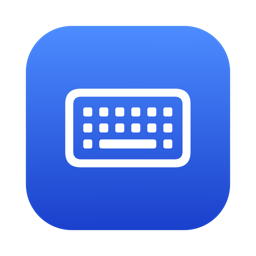
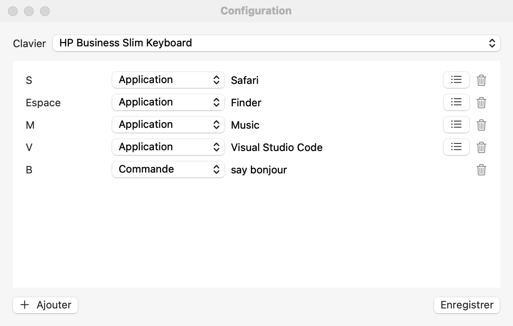
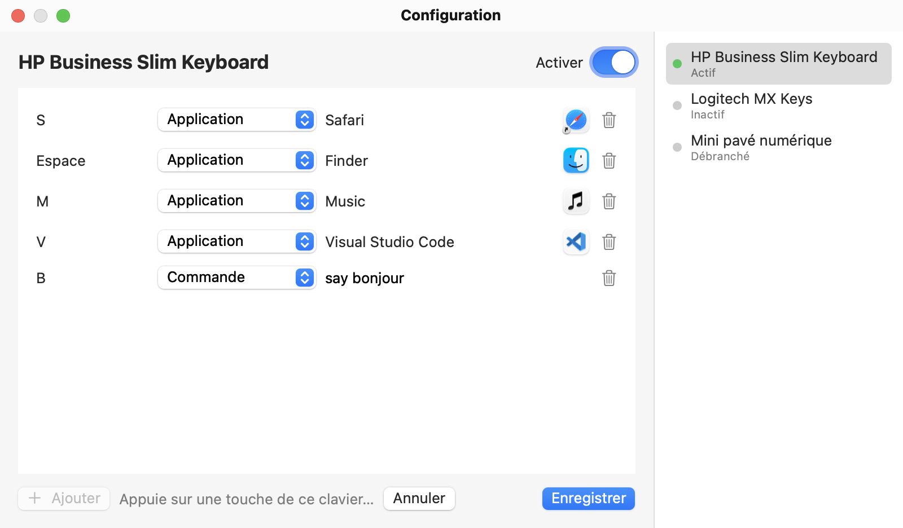

<p align="center"></p>

# KeyboardModifier

[](https://github.com/Hugollbs/KeyboardModifier/actions/workflows/ci.yml) [](LICENSE)

🇫🇷 [Version française](README.md)

A macOS menu bar app that turns an **external keyboard** into a shortcut pad: each key can open an application or run a terminal command.

- You can configure **several external keyboards**, each with its own switch and its own shortcuts.
- Rules only apply to enabled keyboards: the Mac's built-in keyboard is never touched.
- An enabled keyboard's keys are disabled for macOS: they no longer type text, only configured keys trigger an action.
- No Dock icon, no terminal needed: the app lives in the menu bar.

## Installation

### From a release

1. Download `KeyboardModifier-macos-arm64.zip` from [Releases](https://github.com/Hugollbs/KeyboardModifier/releases) (Apple Silicon Macs).
2. Unzip and drag `KeyboardModifier.app` to `/Applications`.
3. On first launch: right-click the app > **Open** (it is not signed with an Apple Developer account).

### From source

```bash
git clone https://github.com/Hugollbs/KeyboardModifier.git
cd KeyboardModifier
./scripts/make-app.sh                      # builds .build/KeyboardModifier.app
cp -R .build/KeyboardModifier.app /Applications/
```

Requirements: macOS 13+, Swift 6 (Xcode).

### Permission

On first launch macOS asks for **Input Monitoring** access (System Settings > Privacy & Security). Tick KeyboardModifier: the app starts by itself as soon as access is granted.

## Usage

Click the keyboard icon in the menu bar:

| Menu item | What it does |
| --- | --- |
| Configurer… | Opens the configuration window |
| Rendre le clavier à macOS | Emergency exit: re-enables the keyboard without quitting (the same item takes control back) |
| Lancer à l'ouverture de session | Starts the app at every login (keep the app at a stable path, e.g. `/Applications`) |
| Quitter | Stops the app and gives the keyboard back to macOS |

### Configuration window



On the right, the list of all keyboards: a green dot marks an **active** keyboard, "Inactif" a keyboard left to macOS, "Débranché" a configured keyboard that is unplugged. Click a keyboard to show its settings in the center.

1. **Activer**: the switch disables (or gives back) this keyboard's keys for macOS, immediately. Each keyboard has its own.
2. **Ajouter**: click it, then press a key on the selected keyboard. A row appears for that key. The keyboard must be enabled for its key to be captured.

   

3. Choose the action type:
   - **Application**: click the field; the list of installed apps opens under it and filters as you type. Pick a name with the mouse or arrow keys + Return. The field is then replaced by the app name and its **icon**; click the name to change app.
   - **Commande**: a command run by `zsh` (e.g. `say bonjour`).
4. **Enregistrer**: shortcuts for all keyboards are saved, apply immediately, and the window closes.

> Screenshots use demo rules. The completion list is a separate system window and does not appear in them.

### Config file

Keyboards and their shortcuts are stored in `~/.config/keyboardmodifier/config.json`. You can also edit it by hand:

```json
{
  "keyboards": [
    {
      "id": { "vendorID": 1008, "productID": 12362 },
      "name": "HP Business Slim Keyboard",
      "enabled": true,
      "rules": [
        { "key": 22, "action": { "type": "app",   "value": "Safari" } },
        { "key": 5,  "action": { "type": "shell", "value": "say bonjour" } }
      ]
    }
  ]
}
```

`key` is the HID usage code of the key (4 = A, 5 = B, 44 = Space…). Without a file the app starts with an empty configuration. A file in the old format (a single keyboard, `keyboard` and `rules` keys) is converted automatically when loaded. A key defined twice is reported (log and warning in the window); the last rule wins.

## How it works

- **Reading keys**: `IOHIDManager` (IOKit) listens to each enabled keyboard, matched by `vendorID` / `productID`, and receives every key press with no latency.
- **Disabling for macOS**: `hidutil` remaps every key of that keyboard to "nothing" (`UserKeyMapping`).
- **After sleep**: macOS recreates the keyboard and loses the `hidutil` mapping; the app re-applies it 3 seconds after wake-up.
- **Actions**: `open -a` for apps, `/bin/zsh -c` for commands, launched without blocking the listener.

## Architecture

`KeyboardManager` (`@MainActor`) holds the config and creates one `Engine` per configured keyboard, started only if it is enabled. Each `Engine` listens to its keyboard and only talks to the system through three protocols, replaced by fakes in the tests:

| Protocol | Role | Real implementation |
| --- | --- | --- |
| `HIDSource` | receives events from the target keyboard | `IOKitHIDSource` (`IOHIDManager`) |
| `KeyMappingController` | disables / re-enables keys for macOS | `HidutilMapping` (`hidutil`) |
| `DisabledKeyboardStore` | remembers on disk which keyboards are disabled | `FileDisabledKeyboardStore` (`state.json`) |

"Is this event a real key press?" is a pure function (`pressedKey`, in `KeyFilter.swift`). Errors are typed (`EngineError`) and messages go to `os.Logger` (Console.app, subsystem `com.hugollbs.keyboardmodifier`).

### Keyboard restoration

A disabled keyboard must always be recoverable:

- on normal exit: SIGINT / SIGTERM or "Quitter" (`applicationWillTerminate`), with `Engine`'s `deinit` as a last safety net;
- after a hard kill (`kill -9`, crash): each disabled keyboard is written to `~/.config/keyboardmodifier/state.json` **before** it is disabled, and the app restores all of them at next launch;
- on demand, with "Rendre le clavier à macOS" in the menu;
- the app refuses to disable a keyboard if it is the only one detected (the Mac would be left without a keyboard).

## Security

`config.json` contains commands executed by `zsh`: anyone who can write it can run code as you. The app therefore creates it with **600** permissions (directory 700) and tightens the permissions of an existing file when loading it. Only put trusted commands in it. `hidutil` is called with an argument array (no shell), and keyboard identifiers are validated before use.

## Troubleshooting

- **Nothing happens**: check that KeyboardModifier is ticked in Input Monitoring.
- **Keyboard still disabled after a crash**: relaunch the app, it restores it automatically. Otherwise, or if the app no longer starts, run with your keyboard IDs:
  ```bash
  hidutil property --matching '{"VendorID":1008,"ProductID":12362}' --set '{"UserKeyMapping":[]}'
  ```
  A reboot also gives the keys back.
- **Stopping the app**: use "Quitter" or "Rendre le clavier à macOS" with the Mac keyboard or the mouse, since an enabled keyboard is disabled for macOS while the app controls it.
- **Error alert**: details are in Console.app (filter: `com.hugollbs.keyboardmodifier`).

## Development

```bash
swift build          # development build
swift test           # unit tests (XCTest)
swift run            # run from the terminal
./scripts/make-app.sh    # build the ad-hoc signed .app
swiftc scripts/make-icon.swift -o /tmp/make-icon && /tmp/make-icon   # regenerate the icon
```

Continuous integration (GitHub Actions) runs `swift build` and `swift test` on every push.

Sources are in `Sources/KeyboardModifier/`: `KeyboardManager.swift` (keyboards and config), `Engine.swift` (one keyboard), `Protocols.swift`, `IOKitHIDSource.swift`, `Remap.swift` (hidutil), `State.swift`, `Config.swift` (JSON file), `ConfigView.swift` (window), `AppDelegate.swift` (menu bar). Tests are in `Tests/KeyboardModifierTests/`.

## License

[MIT](LICENSE)
