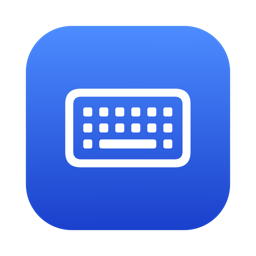
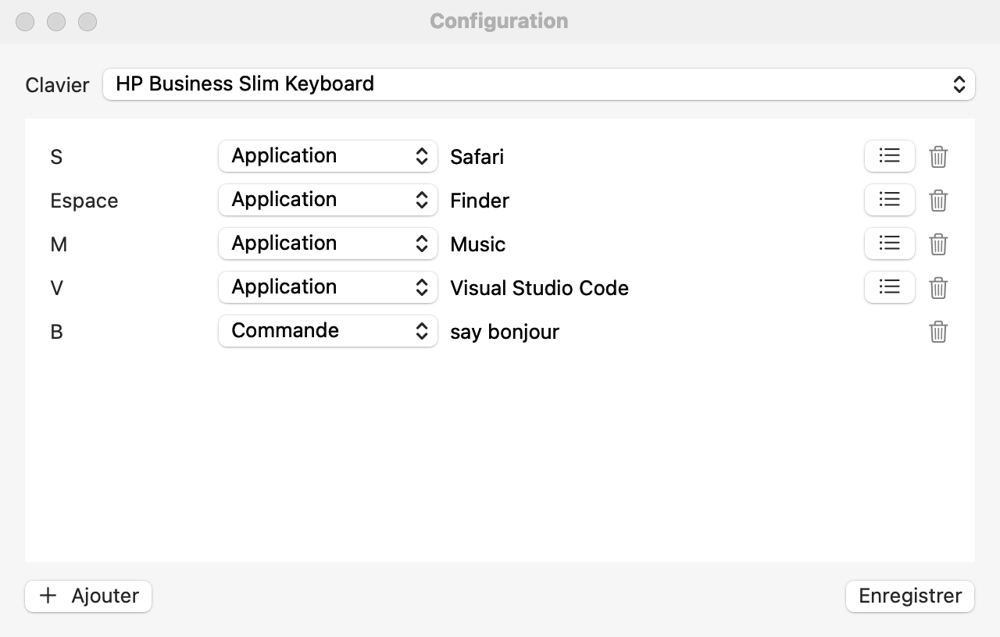
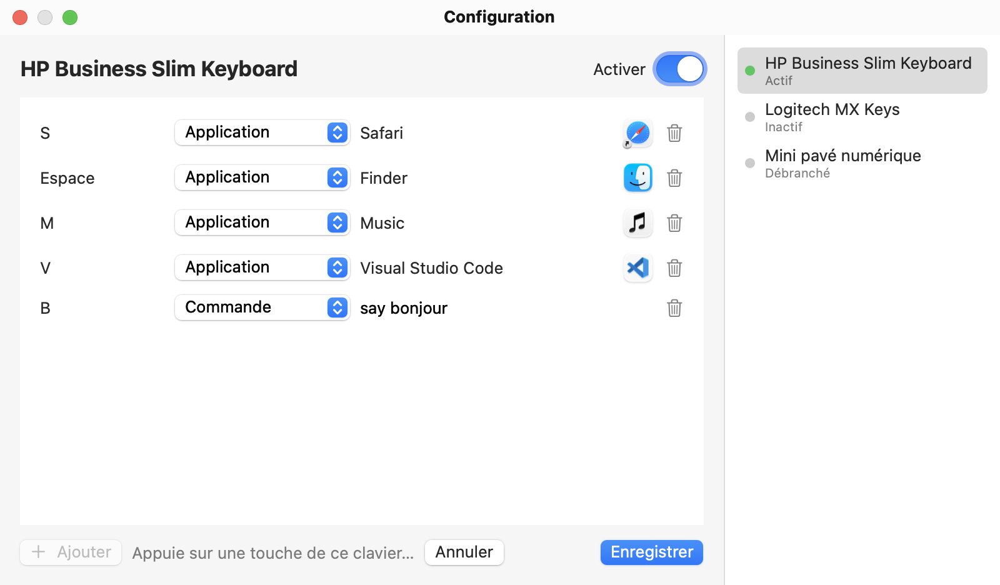

<p align="center"></p>

# KeyboardModifier

[](https://github.com/Hugollbs/KeyboardModifier/actions/workflows/ci.yml) [](LICENSE)

🇬🇧 [English version](README.en.md)

Application macOS de barre de menus qui transforme un **clavier externe** en pupitre de raccourcis : chaque touche peut ouvrir une application ou lancer une commande terminal.

- Tu peux configurer **plusieurs claviers externes**, chacun avec son interrupteur et ses propres raccourcis.
- Les règles ne s'appliquent qu'aux claviers activés : le clavier du Mac n'est jamais touché.
- Les touches d'un clavier activé sont désactivées pour macOS : elles n'écrivent plus de texte, seules les touches configurées déclenchent une action.
- Aucune icône dans le Dock, aucun terminal nécessaire : l'appli vit dans la barre de menus.

## Installation

### Depuis une release

1. Télécharge `KeyboardModifier-macos-arm64.zip` depuis la page [Releases](https://github.com/Hugollbs/KeyboardModifier/releases) (Mac Apple Silicon).
2. Dézippe et glisse `KeyboardModifier.app` dans `/Applications`.
3. Au premier lancement : clic droit sur l'appli > **Ouvrir** (l'appli n'est pas signée par un compte Apple Developer).

### Depuis les sources

```bash
git clone https://github.com/Hugollbs/KeyboardModifier.git
cd KeyboardModifier
./scripts/make-app.sh                      # crée .build/KeyboardModifier.app
cp -R .build/KeyboardModifier.app /Applications/
```

Prérequis : macOS 13 ou plus, Swift 6 (Xcode).

### Autorisation

Au premier lancement, macOS demande l'accès à la **Surveillance de l'entrée** (Réglages Système > Confidentialité et sécurité). Coche KeyboardModifier : l'appli démarre toute seule dès que l'accès est accordé.

## Utilisation

Clique sur l'icône clavier dans la barre de menus :

| Entrée du menu | Rôle |
| --- | --- |
| Configurer… | Ouvre la fenêtre de configuration |
| Rendre le clavier à macOS | Sortie de secours : réactive le clavier sans quitter l'appli (le même item le reprend ensuite) |
| Lancer à l'ouverture de session | Démarre l'appli à chaque connexion (garde l'appli à un emplacement stable, par exemple `/Applications`) |
| Quitter | Arrête l'appli et rend le clavier à macOS |

### La fenêtre de configuration



À droite, la liste de tous les claviers : un point vert signale un clavier **actif**, « Inactif » un clavier laissé à macOS, « Débranché » un clavier configuré mais absent. Un clic sur un clavier affiche ses réglages au centre.

1. **Activer** : l'interrupteur désactive (ou rend) les touches de ce clavier pour macOS, tout de suite. Chaque clavier a le sien.
2. **Ajouter** : clique sur le bouton, puis appuie sur une touche du clavier sélectionné. Une ligne apparaît pour cette touche. Le clavier doit être activé pour que sa touche soit captée.

   

3. Choisis le type d'action :
   - **Application** : clique dans le champ, la liste des applications installées s'ouvre sous le champ (elle peut dépasser de la fenêtre) et se filtre pendant que tu tapes. Choisis un nom, avec la souris ou avec les flèches puis Entrée. Le champ est alors remplacé par le nom de l'appli et son **icône** ; un clic sur le nom permet de changer d'appli.
   - **Commande** : une commande exécutée par `zsh` (ex : `say bonjour`).
4. **Enregistrer** : les raccourcis de tous les claviers sont enregistrés, appliqués tout de suite, et la fenêtre se ferme.

> Les captures utilisent des règles de démonstration. La liste de complétion, qui est une fenêtre système séparée, n'apparaît pas sur les captures.

### Fichier de configuration

Les claviers et leurs raccourcis sont enregistrés dans `~/.config/keyboardmodifier/config.json`. Tu peux aussi l'éditer à la main :

```json
{
  "keyboards": [
    {
      "id": { "vendorID": 1008, "productID": 12362 },
      "name": "HP Business Slim Keyboard",
      "enabled": true,
      "rules": [
        { "key": 22, "action": { "type": "app",   "value": "Safari" } },
        { "key": 5,  "action": { "type": "shell", "value": "say bonjour" } }
      ]
    }
  ]
}
```

`key` est le code HID de la touche (4 = A, 5 = B, 44 = Espace…). Sans fichier, l'appli démarre avec une configuration vide. Un fichier de l'ancien format (un seul clavier, clés `keyboard` et `rules`) est converti automatiquement au chargement.

## Comment ça marche

- **Lecture des touches** : `IOHIDManager` (IOKit) écoute chaque clavier activé, repéré par son `vendorID` / `productID`, et reçoit chaque appui sans latence.
- **Désactivation pour macOS** : `hidutil` remplace toutes les touches de ce clavier par « rien » (`UserKeyMapping`).
- **Après une veille** : macOS recrée le clavier et perd le mapping `hidutil` ; l'appli le ré-applique 3 secondes après le réveil.
- **Actions** : `open -a` pour les applications, `/bin/zsh -c` pour les commandes, lancées sans bloquer l'écoute.

## Architecture

`KeyboardManager` (`@MainActor`) tient la config et crée un `Engine` par clavier configuré, démarré seulement s'il est activé. Chaque `Engine` écoute son clavier et ne parle au système qu'à travers trois protocoles, remplacés par des faux dans les tests :

| Protocole | Rôle | Implémentation réelle |
| --- | --- | --- |
| `HIDSource` | reçoit les événements du clavier ciblé | `IOKitHIDSource` (`IOHIDManager`) |
| `KeyMappingController` | désactive / réactive les touches pour macOS | `HidutilMapping` (`hidutil`) |
| `DisabledKeyboardStore` | mémorise sur disque les claviers désactivés | `FileDisabledKeyboardStore` (`state.json`) |

La décision « cet événement est-il l'appui d'une vraie touche ? » est une fonction pure (`pressedKey`, dans `KeyFilter.swift`). Les erreurs sont typées (`EngineError`) et les messages vont dans `os.Logger` (Console.app, sous-système `com.hugollbs.keyboardmodifier`).

### Restauration du clavier

Un clavier désactivé doit toujours pouvoir être rendu :

- à l'arrêt normal, par SIGINT / SIGTERM ou « Quitter » (`applicationWillTerminate`), et par `deinit` d'`Engine` en dernier filet ;
- après un arrêt brutal (`kill -9`, plantage) : chaque clavier désactivé est noté dans `~/.config/keyboardmodifier/state.json` **avant** la désactivation, et l'appli restaure tous ces claviers au lancement suivant ;
- à la demande, avec « Rendre le clavier à macOS » dans le menu (rend tous les claviers) ;
- l'appli refuse de désactiver un clavier si c'est le seul détecté (le Mac resterait sans clavier).

## Sécurité

`config.json` contient des commandes exécutées par `zsh` : quiconque peut l'écrire peut exécuter du code avec tes droits. L'appli le crée donc en permissions **600** (et son dossier en 700), et resserre celles d'un fichier existant au chargement. Ne mets dans ce fichier que des commandes de confiance. `hidutil` est appelé avec un tableau d'arguments (aucun shell), et les identifiants du clavier sont validés avant usage.

## Dépannage

- **Rien ne se passe** : vérifie que KeyboardModifier est coché dans Surveillance de l'entrée.
- **Le clavier reste désactivé après un plantage** : relance l'appli, elle le restaure automatiquement. Sinon, ou si l'appli ne démarre plus, exécute avec tes identifiants de clavier :
  ```bash
  hidutil property --matching '{"VendorID":1008,"ProductID":12362}' --set '{"UserKeyMapping":[]}'
  ```
  Un redémarrage rend aussi les touches.
- **Arrêter l'appli** : utilise « Quitter » ou « Rendre le clavier à macOS » avec le clavier du Mac ou la souris, car un clavier activé est désactivé pour macOS tant que l'appli le contrôle.
- **Message d'erreur dans une alerte** : les détails sont dans Console.app (filtre : `com.hugollbs.keyboardmodifier`).

## Développement

```bash
swift build          # compilation de développement
swift test           # tests unitaires (XCTest)
swift run            # lance l'appli depuis le terminal
./scripts/make-app.sh    # construit l'appli .app signée (ad hoc)
swiftc scripts/make-icon.swift -o /tmp/make-icon && /tmp/make-icon   # régénère l'icône
```

L'intégration continue (GitHub Actions) lance `swift build` et `swift test` à chaque push.

Les sources sont dans `Sources/KeyboardModifier/` : `KeyboardManager.swift` (claviers et config), `Engine.swift` (un clavier), `Protocols.swift`, `IOKitHIDSource.swift`, `Remap.swift` (hidutil), `State.swift`, `Config.swift` (fichier JSON), `ConfigView.swift` (fenêtre), `AppDelegate.swift` (barre de menus). Les tests sont dans `Tests/KeyboardModifierTests/`.

## Licence

[MIT](LICENSE)
