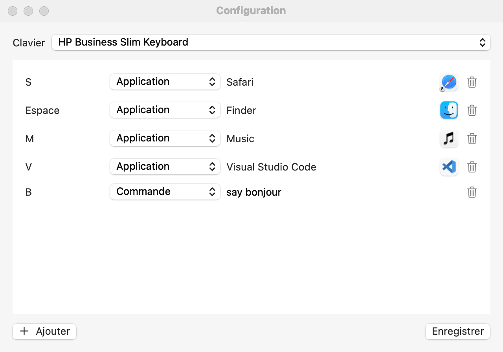
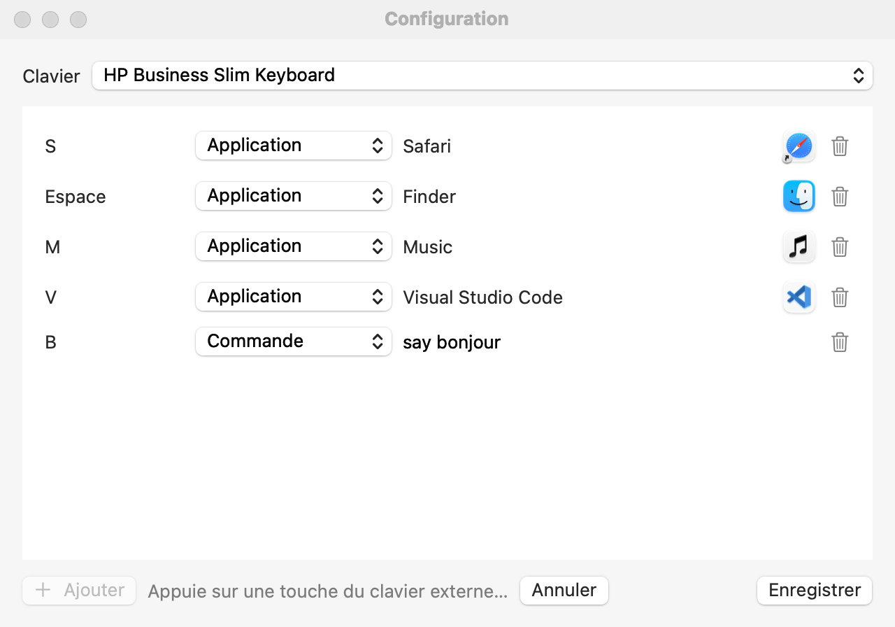

<p align="center"></p>

# KeyboardModifier

Application macOS de barre de menus qui transforme un **clavier externe** en pupitre de raccourcis : chaque touche peut ouvrir une application ou lancer une commande terminal.

- Les règles ne s'appliquent qu'au clavier choisi : le clavier du Mac n'est jamais touché.
- Les touches du clavier choisi sont désactivées pour macOS : elles n'écrivent plus de texte, seules les touches configurées déclenchent une action.
- Aucune icône dans le Dock, aucun terminal nécessaire : l'appli vit dans la barre de menus.

## Installation

### Depuis une release

1. Télécharge `KeyboardModifier-macos-arm64.zip` depuis la page [Releases](https://github.com/Hugollbs/KeyboardModifier/releases) (Mac Apple Silicon).
2. Dézippe et glisse `KeyboardModifier.app` dans `/Applications`.
3. Au premier lancement : clic droit sur l'appli > **Ouvrir** (l'appli n'est pas signée par un compte Apple Developer).

### Depuis les sources

```bash
git clone https://github.com/Hugollbs/KeyboardModifier.git
cd KeyboardModifier
./scripts/make-app.sh                      # crée .build/KeyboardModifier.app
cp -R .build/KeyboardModifier.app /Applications/
```

Prérequis : macOS 13 ou plus, Swift 6 (Xcode).

### Autorisation

Au premier lancement, macOS demande l'accès à la **Surveillance de l'entrée** (Réglages Système > Confidentialité et sécurité). Coche KeyboardModifier : l'appli démarre toute seule dès que l'accès est accordé.

## Utilisation

Clique sur l'icône clavier dans la barre de menus :

| Entrée du menu | Rôle |
| --- | --- |
| Configurer… | Ouvre la fenêtre de configuration |
| Lancer à l'ouverture de session | Démarre l'appli à chaque connexion (garde l'appli à un emplacement stable, par exemple `/Applications`) |
| Quitter | Arrête l'appli et rend le clavier à macOS |

### La fenêtre de configuration



1. **Clavier** : choisis le clavier externe à utiliser (le clavier intégré du Mac n'est pas proposé). Le changement est immédiat.
2. **Ajouter** : clique sur le bouton, puis appuie sur une touche du clavier externe. Une ligne apparaît pour cette touche.

   

3. Choisis le type d'action :
   - **Application** : clique dans le champ, la liste des applications installées s'ouvre sous le champ (elle peut dépasser de la fenêtre) et se filtre pendant que tu tapes. Choisis un nom, avec la souris ou avec les flèches puis Entrée. Le champ est alors remplacé par le nom de l'appli et son **icône** ; un clic sur le nom permet de changer d'appli.
   - **Commande** : une commande exécutée par `zsh` (ex : `say bonjour`).
4. **Enregistrer** : les règles sont appliquées tout de suite et la fenêtre se ferme.

> Les captures utilisent des règles de démonstration. La liste de complétion, qui est une fenêtre système séparée, n'apparaît pas sur les captures.

### Fichier de configuration

Les règles sont enregistrées dans `~/.config/keyboardmodifier/config.json`. Tu peux aussi l'éditer à la main :

```json
{
  "keyboard": { "vendorID": 1008, "productID": 12362 },
  "rules": [
    { "key": 22, "action": { "type": "app",   "value": "Safari" } },
    { "key": 5,  "action": { "type": "shell", "value": "say bonjour" } }
  ]
}
```

`key` est le code HID de la touche (4 = A, 5 = B, 44 = Espace…). Sans fichier, l'appli démarre avec une configuration vide.

## Comment ça marche

- **Lecture des touches** : `IOHIDManager` (IOKit) écoute uniquement le clavier choisi, repéré par son `vendorID` / `productID`, et reçoit chaque appui sans latence.
- **Désactivation pour macOS** : `hidutil` remplace toutes les touches de ce clavier par « rien » (`UserKeyMapping`). Les touches sont rendues à la fermeture de l'appli.
- **Actions** : `open -a` pour les applications, `/bin/zsh -c` pour les commandes, lancées sans bloquer l'écoute.

## Dépannage

- **Rien ne se passe** : vérifie que KeyboardModifier est coché dans Surveillance de l'entrée.
- **Le clavier reste désactivé après un plantage** (ou un `kill -9`) : relance puis quitte l'appli, ou exécute, avec tes identifiants de clavier :
  ```bash
  hidutil property --matching '{"VendorID":1008,"ProductID":12362}' --set '{"UserKeyMapping":[]}'
  ```
  Un redémarrage rend aussi les touches.
- **Arrêter l'appli** : utilise « Quitter » avec le clavier du Mac, car le clavier choisi est désactivé tant que l'appli tourne.

## Développement

```bash
swift build          # compilation de développement
swift run            # lance l'appli depuis le terminal
./scripts/make-app.sh    # construit l'appli .app signée (ad hoc)
swiftc scripts/make-icon.swift -o /tmp/make-icon && /tmp/make-icon   # régénère l'icône
```

Les sources sont dans `Sources/KeyboardModifier/` : `Engine.swift` (écoute et actions), `Config.swift` (fichier JSON), `ConfigView.swift` (fenêtre), `AppDelegate.swift` (barre de menus).
